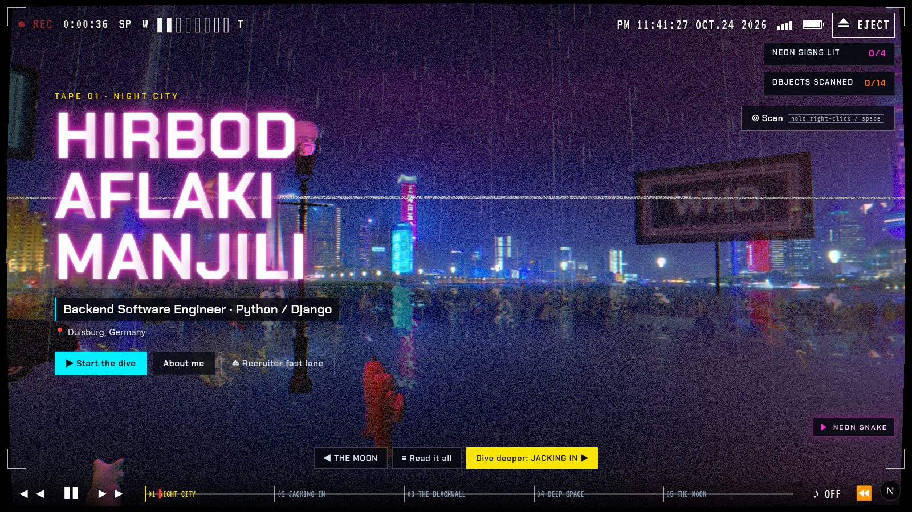
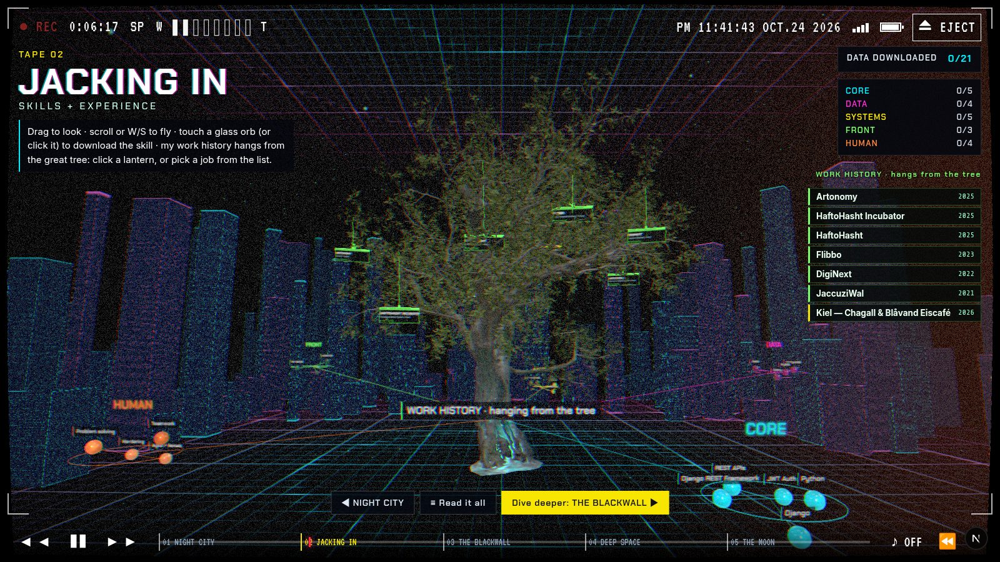
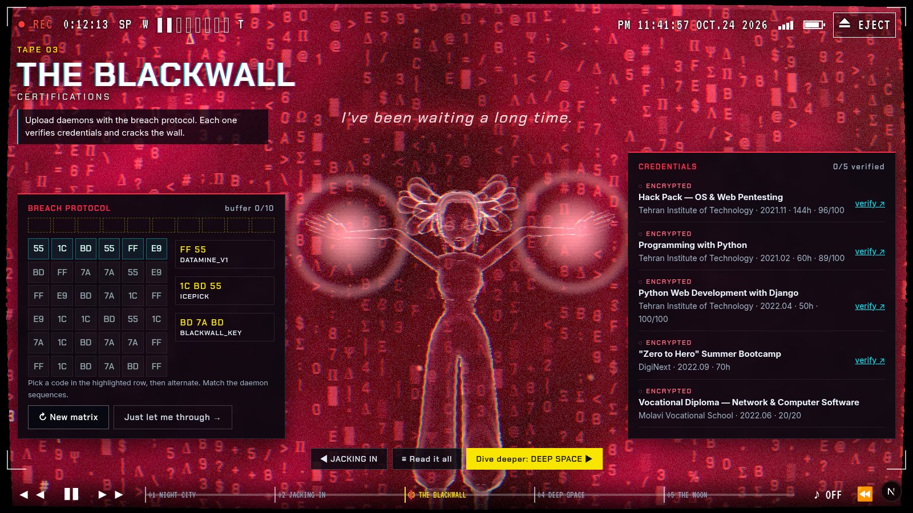
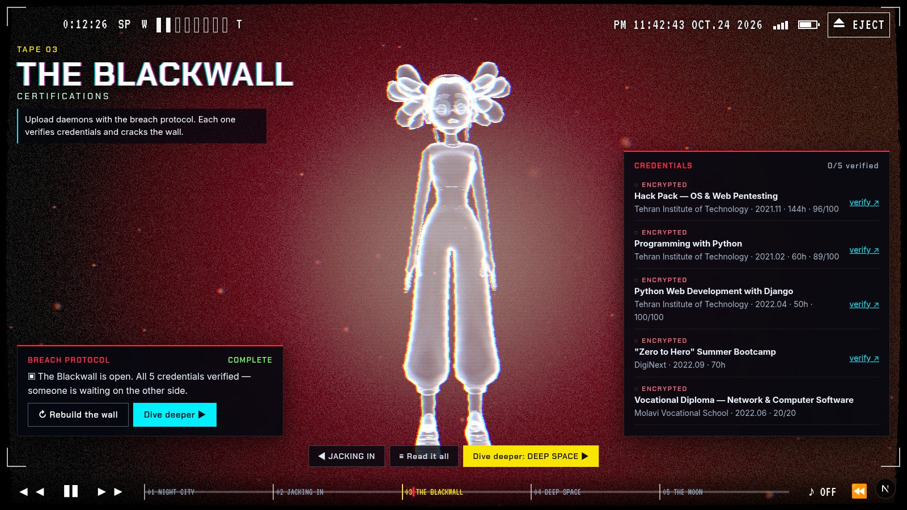
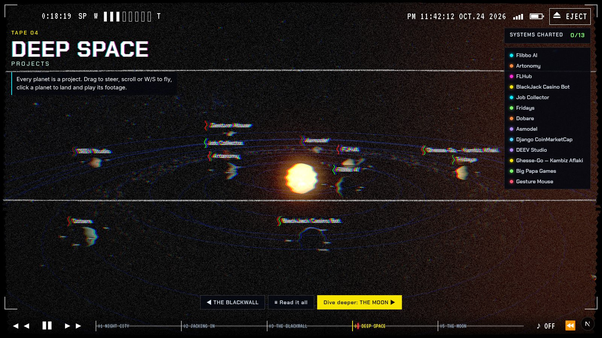
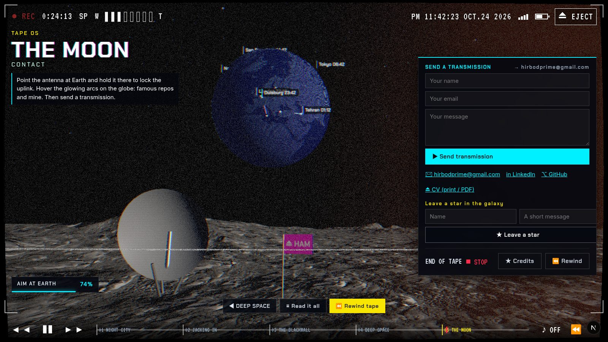

# THE DIVE

**A portfolio you don't scroll — you jack in.**
Live at **[hirbodaflaki.com](https://hirbodaflaki.com)**



A recovered camcorder tape, five chapters deep: from a rain-soaked Night City skyline, through the Net and the Blackwall,
out past the planets to a transmission dish on the Moon. Every chapter is a real-time 3D world you explore, not a page you read,
and every one of them hides my actual work: experience, skills, certifications, projects and a working contact form.

Built from scratch with **Next.js 16, React Three Fiber and hand-written GLSL**: no templates, no page builders,
no game engine. All of it runs live in the browser, behind a single VHS post-processing pass.

## The five tapes

| | |
|---|---|
|  | **02 · Jacking In** — fly through a cyberspace grid around a real 3D tree model from Poly Haven. Work history hangs from its branches as glass lanterns; skill nodes float in the void, waiting to be downloaded. |
|  | **03 · The Blackwall** — play a working breach-protocol minigame. Each daemon you upload verifies a certification and cracks a wall of falling red code. Something on the other side follows your cursor and presses its hands against the glass. |
|  | Break the wall and she reaches through, then steps out and stands in front of you. |
|  | **04 · Deep Space** — every project is a planet with real NASA-derived textures, rings, night lights and atmospheres. Fly between them and land to play the footage. |
|  | **05 · The Moon** — aim a dish at a dotted Earth (with a 1.28 s light-delay beam), hover arcs to famous and personal repos, and send me a transmission. |

**01 · Night City** opens on a 360° Shanghai panorama graded to neon, with lightning, rain and dead signs you switch on.
Hold right-click to use a **Kiroshi-style optical scanner** on the buildings and props.
There's also a playable neon Snake on a tiny CRT in the corner.

## Under the hood

- **Rendering:** React Three Fiber on three.js r186, with custom `ShaderMaterial`s for the Blackwall (Voronoi shatter, glyph rain, palm ripples),
  the holographic netrunner (skinned-mesh fresnel and scanline shader, bones posed procedurally in real time), the sky, the Earth's day/night terminator and atmospheres.
- **Post-processing:** one fused VHS pass (`src/lib/VHSEffect.ts`): tracking noise, chroma bleed, scanlines and tape distortion that reacts to camera speed, plus a Sandevistan afterimage (hold Shift).
- **Assets:** glTF models compressed with meshopt and WebP via gltf-transform. The whole world is under 50 MB, music included.
- **Camera:** a small look/fly/fixed rig (`scenes/controls.ts`) with touch thrusters on mobile.
- **Backend:** Next.js route handlers plus SQLite (better-sqlite3) for visitor stars and contact messages; GitHub API for the live repo arcs.
- **Accessible by default:** every 3D scene has a plain-text "Read it all" drawer, SEO copy is rendered on the server, reduced motion is respected,
  and the **⏏ EJECT** button (`/cv`) gives recruiters a clean, printable A4 CV.
- **Deploy:** GitHub Actions builds a standalone bundle. A 1 GB VPS just downloads it, swaps a symlink and restarts one systemd unit, with nginx serving the static files.

## Controls

`drag` look · `W/S` or scroll fly · `1–5` jump to a tape · `[` `]` previous/next · `space` play/pause · `Shift` Sandevistan ·
`~` behind-the-scenes wireframe · and yes, the Konami code works.

## Run it

```bash
npm install            # also fetches the netrunner model (see Credits)
npm run dev            # http://localhost:3000
```

Make it yours: all text (profile, experience, skills, certifications, projects) lives in `src/content/data.ts`,
scanner entries in `src/content/scan.ts`. Optional env vars are in `.env.example`.

## Deploy

`deploy/` holds the systemd unit, the nginx server block and `deploy.sh`. Every push to `main` publishes a fresh `latest` release;
on the server, `sudo /opt/portfolio/deploy.sh` pulls it and switches over with no build step.

## Credits

Every third-party texture, model, panorama and track is listed in [`src/content/credits.ts`](src/content/credits.ts) and in the in-site credits roll:
Poly Haven (CC0), Solar System Scope (CC BY 4.0), Kevin MacLeod / incompetech (CC BY 4.0), Simple Icons (CC0).
The netrunner is Adobe Mixamo's *Michelle* from the three.js examples. Mixamo's licence doesn't allow redistributing it,
so `npm install` downloads it instead of it living in this repo.

Code is [MIT](LICENSE). Fork the code, not the person: please swap out my content and photo.

Made by **Hirbod Aflaki Manjili** · [hirbodprime@gmail.com](mailto:hirbodprime@gmail.com) · [LinkedIn](https://linkedin.com/in/hirbodprime)
